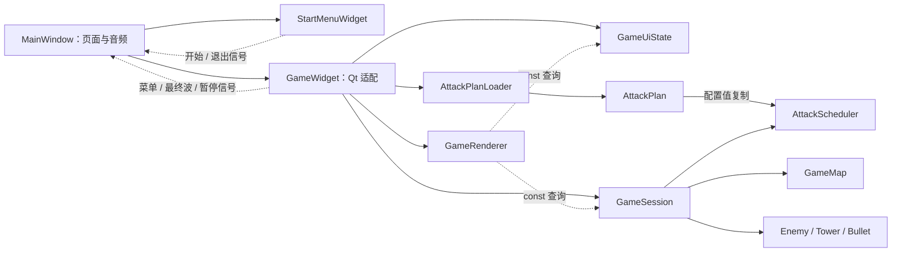

# 项目代码结构

项目使用 C++17、Qt 6 Widgets/Multimedia。核心规则位于 `26C-/core/`，Qt 页面、输入和展示位于 `26C-/ui/`；资源目录和 mainwindow.ui 保留在产品根目录。此文说明当前职责和依赖，实际验证证据由 `HANDOFF.md` 最新轮次记录。

## 职责与依赖

| 模块 | 拥有的职责 | 不跨越的边界 |
| --- | --- | --- |
| `MainWindow` | 页面持有、懒创建/复用游戏页、音乐、应用级信号连接 | 不处理战斗实体与数值 |
| `StartMenuWidget` | 菜单与说明绘制、命中、按钮状态、开始/退出意图 | 不创建游戏，不直接退出应用 |
| `GameWidget` | QTimer、输入到命令、加载路径、Qt 信号、请求重绘 | 不另存生命/金币/胜负，不计算伤害 |
| `GameSession` | 权威战局状态、实体生命周期、经济、战斗、选中实体、胜负 | 无文件读取、QWidget、QPainter 或音频 |
| `GameMap` | 固定尺寸、两条路径、网格和道路几何 | 不依赖窗口或界面面板 |
| `AttackPlanLoader` | 明确路径的读取、校验与整份回退 | 不保存 tick 或运行事件 |
| `AttackPlan` | 已验证配置值，只读查询、整份复制 | 只有 Loader 可构造；不暴露可变波次 |
| `AttackScheduler` | 稳定最小堆、逻辑 tick、出怪/增援/切波 | 不读文件，不创建实体 |
| `Enemy / Tower / Bullet` | 单个实体的移动、技能、攻击冷却、伤害等规则 | 只依赖 QtCore，不绘制、不加载贴图 |
| `GameRenderer` | 图片缓存、地图与全部实体/HUD/覆盖层绘制、共享命中布局 | 只读 Session/UiState，不推进模型 |
| `EnemyArtwork` | 菜单与战斗共用的透明留白裁切及等比缩放 | 仅展示层加载时使用，不修改实体或源素材 |
| `GameUiState` | 悬停、按压、鼠标、候选塔型、预览、字幕 | 不复制战局状态或选中实体 |
| `UiDrawing` | 菜单和战斗共用的按钮反馈绘制 | 不抽象业务输入或页面生命周期 |



`game_core` 是只链接 Qt6::Core 的静态库；“QtCore-only”不表示不使用 Qt。UI 链接 Qt6::Gui/Widgets/Multimedia。产品和外层测试共用 `26C-/cmake/GameTargets.cmake`，新增模块必须进入该清单，避免两套独立产品源列表漂移。

## 所有权与状态

- MainWindow 持有页面及音频指针，Qt 父子关系负责 QObject 生命周期；首次开始才创建 GameWidget，之后复用，连接只建立一次。
- GameWidget 按值持有 Session、Renderer、UiState；QTimer 以游戏页为父对象。
- Session 独占三个 `QVector<T*>` 中的 Enemy、Tower、Bullet；禁止复制。Bullet 的目标与 Session 的选中塔只是借用引用。
- 删除敌人前先删关联子弹；清空时先删全部子弹，再删敌人和塔，最后清选中引用。出售塔清选中，不销毁已经发射的子弹。
- Tower::updateAttack() 只返回借用目标，Session 创建子弹并复制当时伤害。展示不在实体上保存 selected 副本。
- Session::State 唯一定义 Stopped、Running、Paused、Won、Lost；QTimer 是否活动由 GameWidget::syncTimer() 同步，不以 QWidget 隐藏代替暂停。
- Renderer 构造时缓存图像，跨帧不缓存实体地址。实体通过类型、生命及强化/变异只读查询提供绘制信息。普通塔、速射塔、重炮塔头像从 `images/towers/{normal,fast,heavy}.png` 加载一次并缓存；这些PNG无损保存原菜单中的裁图像素，不再依赖旧菜单文件。`drawTower()` 与 `drawBuildPreview()` 共用私有 `drawTowerVisual()` 绘制角色原画、类型色边框与等级徽章，预览以 0.72 透明度叠加有效性色圈。核心 `Tower` 维持 QtCore-only，无任何绘图或 QPixmap 依赖。
- StartMenuWidget 缓存四类真实敌人（bug/ddl/virus/boss）图标，在进入菜单背景上叠加纸张渐变卡片展示，保留原有按钮反馈与 `quitRequested` 信号。
- 五种敌人形态统一读取 `images/enemies/{bug,ddl,virus,mutant,boss}.png`。`EnemyArtwork::load()` 在加载时去除透明留白并等比缩放，由Renderer/菜单各自缓存；战斗使用原65×65或Boss 75×75包围框，图像底边与原占位底边对齐，不再强制拉伸到正方形。血条宽度与位置仍依原占位计算；病毒真实变异后切换mutant图。用户原始JPG与处理记录保存在 `art/enemies/`，不编入运行资源。
- 菜单、说明和胜负页读取 `images/screens/{menu,help,win,lose}.png`，在原1200×800页面布局中显示。背景中的旧敌人按原三角色位置替换为已确认的普通怪、快攻怪和Boss，按钮命中区域与战斗界面保持。九份旧敌人/背景文件已清理，来源可从Git历史追溯；处理与提取记录位于 `art/screens/`、`art/towers/`，用户提供的敌人原始JPG继续保存在 `art/enemies/source/`。

## 单帧与输入契约

1. Running 才推进；Scheduler 使用移动和清理前的敌人数，执行到期出怪、增援和切波。
2. 敌人先技能后移动；全部塔选敌并由 Session 造弹；全部子弹更新，新弹当 tick 生效。
3. 逆序清理结束子弹；逆序处理敌人，终点优先死亡；结算漏怪/奖励及 Boss 光环，删敌人前清关联子弹。
4. Session 判断生命耗尽，否则检查全部生成且敌人为空；返回 FrameResult。
5. GameWidget 应用通知和最终波信号，实际推进时字幕当帧减一，同步定时器并请求绘制。Renderer 不更新战局。

目标 tick 间隔为 30 ms，未采用 delta time。暂停冻结 tick、攻击和字幕；P/Esc 忽略自动重复键。失焦清输入状态，但不自动暂停。重试 `restartGame(true)`，返回菜单 `restartGame(false)`；配置成功且要求运行时才开表。

地图合法性由 Session/GameMap 检查；HUD、按钮与展开的事件面板遮挡由 Renderer 的布局入口检查。候选塔预览和实际点击共用组合判定。现有塔选择归 Session，候选建造塔型归 UiState。普通按钮按下记录、松开同目标触发，拖出取消；建塔仍在地图左键按下时执行。

## 配置、资源与兼容行为

调用链为 `GameWidget → AttackPlanLoader → AttackPlan → GameSession / AttackScheduler`。适配层组装 `:/config/attack_waves.json` 和可执行文件目录下的 `attack_rhythm.json`；Loader 不隐式推断路径，Scheduler/Session 不读取文件。

内置计划失败不允许开局。外部路径为空或不存在使用默认值；存在但无效则整份回退并返回 warning，不部分覆盖。外部只修改七项节奏字段，不改敌人名单；每次开始或重试重新加载，不热更新。示例文件需复制或更名才启用。约束常量集中在 `attackplan.h`，Loader 与运行时溢出保护共享边界。

保留六波 90 敌人及原始轨迹，默认清场阈值 6，切波时间为首次满足条件 tick 加等待参数减一。所有价格、伤害、速度、奖励、生命映射取整规则保持。实体基础参数和视觉参数分开；五种敌人PNG均为静态贴图，最终波仍重播 battle.mp3 并播放一次 final_wave.wav。

完整资源只由产品或 GUI 测试可执行文件嵌入；核心静态库不打包资源。调度/战局测试使用仅配置 qrc，备用绘制测试刻意不带图片。qrc 路径和资源文件目录不随代码分层搬迁。

## 两个构建入口与验证

以下是匹配 Qt 6 kit、编译器和 Ninja 已在环境中可用时的命令模板；`<Qt6 kit>` 需替换为实际 kit 前缀，不代表已执行。

```powershell
cmake -S 26C- -B builds/architecture-product -G Ninja -DCMAKE_PREFIX_PATH="<Qt6 kit>"
cmake --build builds/architecture-product

cmake -S tests -B builds/architecture-tests -G Ninja -DCMAKE_PREFIX_PATH="<Qt6 kit>"
cmake --build builds/architecture-tests
ctest --test-dir builds/architecture-tests --output-on-failure
```

产品目标为 `final`。测试入口定义 attack_scheduler、enemy_product、session_product、entity_rendering、gui_product；前三者使用真实核心实现，后两者使用真实绘制与页面实现。GUI/绘制测试配置 offscreen，不能代替真实桌面和听音验收。菜单几何脚本读取当前菜单源码，检查范围不等于完整图像贴合结论。

每次结构调整需在新的隔离目录编译两入口并执行针对性回归及 `git diff --check`；必要时用动态依赖检查确认核心测试未链接 QtGui/Widgets。此文不保存易过期的通过数量和本机绝对工具路径，实际命令、版本、退出码和限制记录在 HANDOFF。
