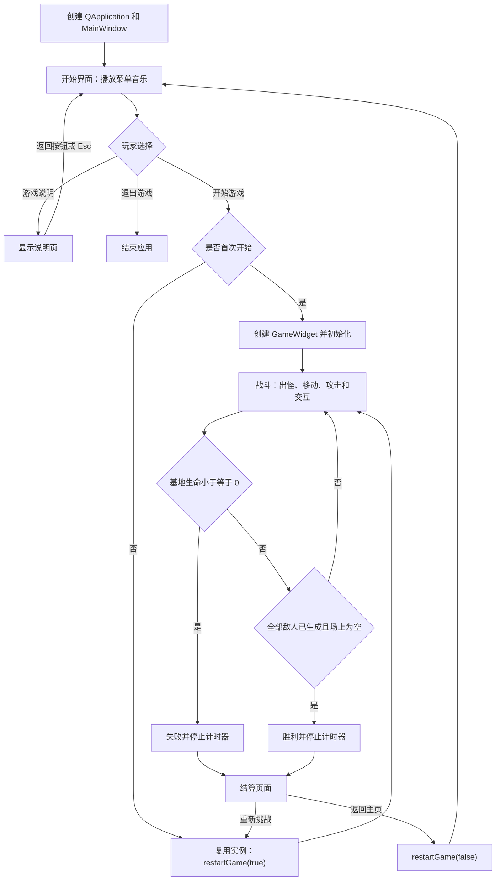
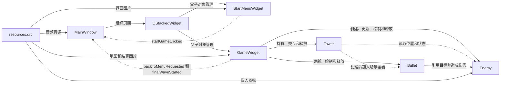
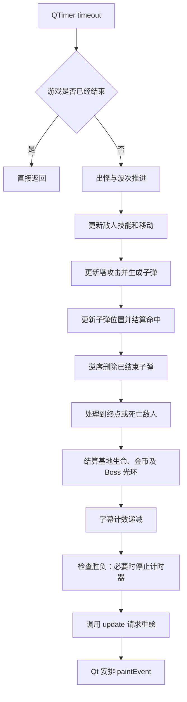

# “顶流争夺保卫战”项目报告补充

本文依据截至 2026 年 10 月 14 日的项目源码，补充第四章“项目总体设计”和第五章“主要模块设计与实现”，可作为原实验报告相应章节的正文。图示采用 Mermaid，代码片段标明源码节选或伪代码；各项参数均以当前实现为准。

## 四、项目总体设计

### 1. 整体流程

“顶流争夺保卫战”采用菜单、战斗、结算三个阶段组织玩家操作。程序启动时，首先创建 `QApplication` 和 `MainWindow`，显示开始界面并播放菜单背景音乐。开始界面提供“开始游戏”“游戏说明”“退出游戏”三个入口，其中说明页与菜单页由同一个 `StartMenuWidget` 切换显示。

玩家首次点击“开始游戏”后，`MainWindow` 创建 `GameWidget`，将其加入 `QStackedWidget` 并切换为当前页面。`GameWidget` 初始化地图路径、敌人波次和游戏状态，再启动定时器。初始金币为 150，基地生命为 10，当前波次为第 1 波。后续再次从菜单进入游戏时复用已有游戏实例，通过重置函数重新开始。

战斗阶段以定时更新为基础。程序按波次队列逐步生成敌人，并将敌人交替安排到两条路线。玩家通过鼠标建造或选择防御塔，通过键盘切换塔型、升级和出售。防御塔在攻击范围内选择目标并生成子弹，子弹追踪目标并结算伤害。击败敌人获得金币，敌人到达终点则扣除基地生命。金币、基地生命、波次和生成数量由状态栏实时显示。

每次逻辑更新结束后，程序检查胜负。基地生命小于等于 0 时判定失败；基地生命仍大于 0、全部敌人已生成且场上没有敌人时判定胜利。这里的“场上没有敌人”包括敌人被击败或已经到达终点后被移除，因此胜利条件并不要求击杀所有敌人，而是要求在全部进攻结束后仍保有基地生命。

游戏结束后停止定时器，显示胜利或失败页面。玩家可以选择“重新挑战”，清空旧对象并恢复初始状态后立即开始；也可以选择“返回主页”，重置状态但保持计时器停止，再切回菜单。这样的控制把“恢复初始状态”和“开始运行”两个动作区分开，避免隐藏的游戏页面继续推进战斗。

**图 4-1 游戏整体流程**



图中，菜单、说明页和战斗页面之间的切换由 Qt 事件驱动；战斗中的循环由定时器驱动。两个结算出口共用状态重置逻辑，但启动计时器的参数不同。再次开始或重新挑战均恢复新局状态，不会沿用上一局的敌人、防御塔、子弹或金币。

**实现依据：** `26C-/main.cpp` 的 `main()`；`26C-/mainwindow.cpp` 的 `MainWindow::MainWindow()`；`26C-/gamewidget.cpp` 的构造函数、`checkGameResult()`、`mousePressEvent()` 和 `restartGame()`。

### 2. 类与模块划分

项目围绕界面组织、战斗调度和游戏对象划分为六个核心类。窗口类处理页面和输入，敌人、防御塔、子弹类分别封装自身状态和行为，资源系统提供图片与音频。这样的划分使主场景负责协调对象，而各类对象负责执行具体规则。

| 模块或类 | 主要职责 | 核心数据或接口 | 与其他模块的关系 |
| --- | --- | --- | --- |
| `MainWindow` | 页面组织、游戏实例创建与复用、背景音乐及最终波音效 | `QStackedWidget`、`QMediaPlayer`、`QAudioOutput`、`QSoundEffect` | 接收菜单开始信号、游戏返回菜单信号和最终波信号 |
| `StartMenuWidget` | 菜单和说明页绘制、鼠标命中、悬停光标、说明页返回 | 背景图片、按钮矩形、`m_showHelp`、`startGameClicked()` | 发出开始信号，由主窗口负责创建或切换游戏页面 |
| `GameWidget` | 游戏循环、波次、路径、交互、经济规则、对象清理和结算 | 敌人、塔、子弹容器及金币、生命、波次状态 | 统一调用三个游戏对象类的更新和绘制接口 |
| `Enemy` | 路径移动、生命与护甲、受伤、奖励、冲刺、变异及强化 | 路径点、目标点索引、基础属性、强化标志 | 向塔和子弹提供位置与存活状态，向主场景提供奖励和漏怪扣血值 |
| `Tower` | 塔型属性、攻击时机、目标选择、升级属性和出售价值 | `TowerType`、等级、攻击范围、伤害、攻击计数器 | 创建子弹并交由主场景容器管理；经济校验由主场景完成 |
| `Bullet` | 追踪目标、命中伤害、结束状态及绘制 | 位置、目标 `Enemy*`、伤害、移动速度 | 引用敌人但不拥有敌人，生命周期由主场景管理 |
| `resources.qrc` | 定义图片和音频的资源路径 | `/images`、`/audio` 等资源前缀 | 为界面、敌人图标和音频播放器提供嵌入资源 |

界面模块使用 Qt 的继承体系：`MainWindow` 继承 `QMainWindow`，`StartMenuWidget` 和 `GameWidget` 继承 `QWidget`，通过重写绘制、鼠标和键盘事件实现交互。`Enemy`、`Tower` 和 `Bullet` 是普通 C++ 类，其中不同敌人和不同塔型通过类型字段与属性配置区分。

**图 4-2 模块协作与对象关系**



图中实线主要表示页面组织、对象管理或资源供给，虚线表示信号通知、对象查询或目标引用。防御塔创建子弹后将指针加入主场景的子弹容器；子弹保存敌人指针用于追踪，但不负责删除敌人。对象的创建、引用和销毁责任由此能够分别说明。

项目使用 `QVector` 保存顺序数据。`QVector<QVector<QPointF>>` 存放多条路径，每条路径由有序坐标点组成；`QVector<QVector<QString>>` 存放波次与各波的敌人类型序列；敌人、防御塔和子弹分别存放在指针容器中。波次中的序列决定生成顺序，敌人容器中的遍历顺序也影响防御塔选择哪个可攻击目标。

三个游戏对象容器保存的是指针，清空容器前仍需释放其指向的对象。主场景在运行中删除敌人前清理引用该敌人的子弹，出售防御塔后清空选中指针，重新开始和析构时批量释放游戏对象。相对地，定时器和音频播放器等 Qt 对象设置了父对象，可随父对象的销毁进行清理。

模块之间的页面通知采用信号槽。例如菜单发出 `startGameClicked()`，并不直接操作战斗状态；游戏发出 `backToMenuRequested()`，由主窗口完成页面与音乐切换。`finalWaveStarted()` 将波次推进与音频控制连接起来，使战斗逻辑无需直接持有音频播放器。

**实现依据：** `26C-/mainwindow.cpp` 的页面创建与三个信号连接；`26C-/gamewidget.h` 的成员容器和信号声明；`26C-/enemy.h`、`tower.h`、`bullet.h` 的类定义；`26C-/gamewidget.cpp` 的对象清理函数及 `26C-/resources.qrc`。

### 3. 游戏循环设计

项目以 Qt 事件循环作为运行基础。`QApplication::exec()` 负责接收和分发窗口事件，`GameWidget` 中的 `QTimer` 发出 `timeout` 信号后调用 `updateGame()`。这使游戏逻辑能够与鼠标、键盘和绘制事件共同在主线程中执行，避免用持续执行的业务循环占住界面事件处理。

下面为定时器初始化的**源码节选**：

```cpp
m_timer = new QTimer(this);
connect(m_timer, &QTimer::timeout, this, &GameWidget::updateGame);
m_timer->start(30);
```

定时器的目标间隔为 30 ms，理想情况下每秒约进行 33 次逻辑更新。本文的“帧”指一次逻辑更新，速度单位为 px/逻辑帧，攻击或技能持续时间以逻辑帧数计量。当前实现没有按实际经过时间乘以时间增量，定时器调度和系统负载会影响实际时间；30 ms 也不等于保证固定的屏幕刷新率。

`updateGame()` 按下列顺序执行：

| 顺序 | 处理阶段 | 主要工作与顺序意义 |
| --- | --- | --- |
| 1 | 结束状态检查 | 游戏已经结束时立即返回，避免继续更新战斗 |
| 2 | 出怪与波次推进 | 处理小队出怪计数器、生成敌人、切换波次和发出最终波信号 |
| 3 | 敌人更新 | 先处理特殊能力，再沿路径移动，更新到终点状态 |
| 4 | 防御塔攻击 | 根据敌人更新后的位置选择目标，将新子弹加入场景 |
| 5 | 子弹更新 | 移动、检查命中并调用敌人的受伤函数；本帧新生成的子弹也会进入该阶段 |
| 6 | 子弹清理 | 逆序删除已经命中或失效的子弹 |
| 7 | 敌人离场处理 | 优先处理到终点的敌人，再处理死亡敌人；结算基地扣血或金币奖励 |
| 8 | 字幕与胜负检查 | 字幕剩余帧数递减，根据更新后的状态判断结算 |
| 9 | 请求重绘 | 调用 `update()`，由 Qt 随后安排绘制事件 |

**图 4-3 单次逻辑更新流程**



更新顺序保证防御塔使用敌人本次移动后的位置进行范围判断，子弹伤害在敌人死亡结算前生效。对象属性更新的遍历与对象删除的遍历分开进行；删除阶段从容器尾部向前遍历，使删除元素后的索引移动不影响尚未处理的前部元素。

逻辑更新和画面绘制分别由 `updateGame()`、`paintEvent()` 完成。`update()` 是请求刷新，并不等同于在当前位置同步完成一次绘图。在绘制事件中，程序依次绘制地图、可选的调试网格和路径、起终点标记、塔、敌人、子弹、状态栏及字幕；游戏结束后再将结算画面覆盖在场景上。绘制过程读取当前状态，不承担出怪、扣血或金币结算。

**实现依据：** `26C-/main.cpp` 的 `main()`；`26C-/gamewidget.cpp` 的构造函数、`updateGame()`、`paintEvent()` 和 `checkGameResult()`。

## 五、主要模块设计与实现

### 1. 开始界面与说明界面

开始界面由 `StartMenuWidget` 实现，固定大小为 1200×800。菜单和说明页各自使用一张背景图片，由 `QPainter::drawPixmap()` 绘制到整个控件区域。图片负责表现按钮和页面内容，实际交互由程序中的矩形范围判定完成。

`m_showHelp` 表示当前是否处于说明页。为 `false` 时显示菜单图片，为 `true` 时显示说明图片。点击“游戏说明”会修改该标志并请求重绘；说明页中只处理返回区域的点击，避免将说明页点击误当作菜单操作。按 Esc 也可以将该标志恢复为 `false`。

开始按钮发出 `startGameClicked()`，主窗口接收到后创建或复用游戏页面；退出按钮调用 `QApplication::quit()`。这样的实现把菜单的输入识别与游戏实例的管理分开。控件设置了强焦点策略，主窗口切回菜单时也将焦点交给菜单，以便接收键盘事件。

当前矩形配置如下，坐标单位为 px：

| 点击区域 | `QRect(x, y, width, height)` | 包含的横坐标范围 | 包含的纵坐标范围 |
| --- | --- | --- | --- |
| 开始游戏 | `QRect(218, 345, 303, 83)` | 218～520 | 345～427 |
| 游戏说明 | `QRect(239, 446, 261, 63)` | 239～499 | 446～508 |
| 退出游戏 | `QRect(239, 526, 261, 63)` | 239～499 | 526～588 |
| 说明页返回 | `QRect(230, 695, 280, 75)` | 230～509 | 695～769 |

整数 `QRect` 的右、下端点分别为 `x + width - 1` 和 `y + height - 1`，表中范围据此计算。返回区域实际位于说明页下方；这些矩形描述程序命中范围，不表示已经对图片全部边缘完成了运行验收。

菜单开始操作的**源码节选**如下：

```cpp
if (m_startButtonRect.contains(clickPos)) {
    emit startGameClicked();
    return;
}
```

鼠标悬停通过 `mouseMoveEvent()` 调用 `isOnButton()` 判定：位于有效按钮区域时设置手形光标，否则恢复箭头。点击和悬停共用同一组矩形，说明页则只检测返回矩形。菜单还设置了 `setMouseTracking(true)`，以便在没有按下鼠标键时接收移动事件。

背景图片加载失败时，绘制函数显示备用底色与文字提示。备用绘制可以使资源问题表现为可识别的界面信息，但不会改变按钮矩形或页面逻辑。

**实现依据：** `26C-/startmenuwidget.cpp` 的构造函数、`paintEvent()`、`mousePressEvent()`、`mouseMoveEvent()`、`keyPressEvent()` 和 `isOnButton()`；`26C-/mainwindow.cpp` 的开始游戏信号连接。

### 2. 地图与路径设计

地图的视觉背景使用 `game_map.jpg`，战斗坐标固定在 1200×800 的场景内。敌人路线由 `initPaths()` 中的坐标点序列定义，图片道路本身不参与路径计算。路线依次连接各点形成折线，因此移动方向和建塔禁区均能基于同一套坐标数据计算。

当前设置了两个起点和一个共同终点：

| 路线 | 按移动顺序排列的路径点 |
| --- | --- |
| 上方路线 | (40,230) → (305,230) → (305,90) → (635,90) → (635,315) → (1050,315) |
| 下方路线 | (40,570) → (335,570) → (335,690) → (760,690) → (525,395) → (745,485) → (1050,485) → (1050,315) |

生成敌人时，`m_nextPathIndex` 对路线数量取模，并在每次生成后递增。下面为**源码节选**：

```cpp
int pathIndex = m_nextPathIndex % static_cast<int>(m_paths.size());
m_nextPathIndex++;
QVector<QPointF> selectedPath = m_paths[pathIndex];
Enemy* enemy = new Enemy(type, selectedPath);
```

两条路线会按生成顺序交替分配，分配计数在一局内持续累积，重新开始时恢复为 0。敌人获得自己的路径点序列，从首点出发，以 `m_targetIndex` 指向当前目标点。

设当前位置为 `(x, y)`，目标点为 `(tx, ty)`，每帧移动速度为 `v`。移动计算为：

```text
dx = tx - x
dy = ty - y
distance = sqrt(dx² + dy²)

distance <= v：直接到达目标点，并切换下一个目标
distance > v ：x += v × dx / distance
               y += v × dy / distance
```

这段公式为移动算法的数学说明。方向向量除以长度后得到单位方向，再乘以移动速度，可以使水平、垂直和斜向移动使用同一个速度尺度。接近目标时直接落到目标点，避免跨过转折点后往返修正；到达最后一个点时标记为已到终点。当前每次更新处理一个目标点，没有把剩余移动距离继续分配到下一段路线。

建塔位置先吸附到 60 px 网格中心。对非负点击坐标，代码先求所属网格的整数索引，再返回该格中心：

```cpp
int gridSize = 60;
int gridX = static_cast<int>(pos.x()) / gridSize;
int gridY = static_cast<int>(pos.y()) / gridSize;
return QPointF(gridX * gridSize + gridSize / 2,
               gridY * gridSize + gridSize / 2);
```

以上为 `snapToGrid()` 的**源码节选**。即使调试网格没有显示，网格吸附仍参与建造；默认画面以地图背景为主，旧网格和路径线仅在调试开关开启时绘制。

位置合法性检查包括三部分：候选塔中心的纵坐标不能小于 80，以避开顶部状态栏；到任一路径线段的距离不能小于 45；与已有塔中心的距离不能小于 42。这些检查使用吸附后的候选位置。

计算点 `p` 到线段 `ab` 的距离时，程序先计算投影比例：

```text
v = b - a
w = p - a
t = (w · v) / (v · v)
t 限制在 [0, 1]
projection = a + t × v
distance = |p - projection|
```

投影比例限制在 0～1 后，最近点始终位于线段内部或端点，而不会延伸到无限长直线上。当 `a` 和 `b` 重合时，直接求点到端点的距离，避免除以零。由同一条路径同时驱动敌人移动和建塔距离检查，可以使战斗逻辑与建筑限制保持一致。

**实现依据：** `26C-/gamewidget.cpp` 的 `initPaths()`、`spawnEnemy()`、`snapToGrid()`、`distanceToSegment()`、`canBuildTowerAt()` 和 `paintEvent()`；`26C-/enemy.cpp` 的构造函数与 `update()`。

### 3. 敌人系统

敌人系统由 `Enemy` 管理单个对象的类型、位置、路径进度、生命、护甲、速度、奖励和技能状态。`GameWidget` 负责按波次创建敌人并处理离场结算，`Enemy` 自身负责移动、受伤及特殊能力。每次更新先跳过死亡或已经到终点的敌人，再处理技能和路径移动。

#### （1）基础属性与伤害规则

下表列出未获得晚期强化或 Boss 光环的基础配置。Mutant 由 Virus 在移动过程中变异产生，不是波次队列直接生成的类型。

| 类型 | 基础最大生命 | 基础护甲 | 速度（px/逻辑帧） | 击败奖励（金币） | 到终点扣除基地生命 | 特征 |
| --- | --- | --- | --- | --- | --- | --- |
| Bug | 40 | 0 | 2.4 | 10 | 1 | 普通敌人 |
| DDL | 28 | 0 | 3.6 | 15 | 1 | 路径中段触发一次冲刺 |
| Virus | 130 | 8 | 2.0 | 25 | 2 | 路径中段触发一次变异 |
| Boss | 550 | 18 | 1.35 | 100 | 5 | 最终波出现并触发全场光环 |
| Mutant | 160 | 12 | 1.2 | 60 | 2 | 变异后的 Virus，保留已有强化标志 |

当前伤害采用护甲抵消和最低伤害规则：

```text
实际伤害 = max(1, 子弹伤害 - 当前护甲)
受伤后生命 = max(0, 当前生命 - 实际伤害)
```

因此护甲可以降低伤害，但不会让敌人完全免疫攻击。死亡判定为当前生命小于等于 0，受伤函数将负生命裁剪为 0。绘图时按当前生命与最大生命的比例绘制绿色血条，敌人图标加载失败则使用备用颜色和文字绘制。

#### （2）波次与小队生成

波次数据保存为敌人类型的有序序列，六波的实际配置如下：

| 波次 | Bug 数量 | DDL 数量 | Virus 数量 | Boss 数量 | 合计 | 每组计划数量 | 小队触发阈值（逻辑帧） |
| --- | --- | --- | --- | --- | --- | --- | --- |
| 第 1 波 | 8 | 0 | 0 | 0 | 8 | 1 | 14 |
| 第 2 波 | 8 | 6 | 0 | 0 | 14 | 1 | 12 |
| 第 3 波 | 8 | 10 | 0 | 0 | 18 | 2 | 10 |
| 第 4 波 | 6 | 0 | 4 | 0 | 10 | 2 | 8 |
| 第 5 波 | 0 | 10 | 4 | 0 | 14 | 3 | 8 |
| 第 6 波 | 0 | 20 | 5 | 1 | 26 | 3 | 8 |
| 合计 | 30 | 46 | 13 | 1 | 90 | — | — |

每波按源码的追加顺序生成，第 2～5 波也不是随机混排。第 6 波的顺序为 4 个 DDL、3 个 Virus、1 个 Boss、2 个 Virus、16 个 DDL。Mutant 是已有 Virus 的形态变化，不额外增加总敌人数。

小队触发阈值根据零起始波次索引计算为 `max(8, 14 - 波次索引 × 2)`。尚未进行小队生成时，计数达到阈值会设置本组计划生成数量；进入小队状态后，每隔 9 个逻辑帧实际生成一个敌人，直到本组结束或本波队列耗尽。这里的阈值是计数器触发条件，不等同于相邻敌人之间固定的时间间隔。

波次衔接在当前波全部生成后进行。当场上敌人数量不超过 6，且尚有下一波时，波间等待计数开始累积；达到 20 个逻辑帧后进入下一波。因此下一波可以在上一波仍有少量敌人时开始，形成连续进攻。最终波开始时同时显示字幕并发出 `finalWaveStarted()`。

#### （3）DDL 冲刺与 Virus 变异

DDL 通过 `m_hasDashed` 和 `m_isDashing` 区分是否已经使用技能、当前是否处于冲刺。当前目标点索引达到 `m_path.size() / 2` 时触发一次冲刺，速度变为基础速度的 1.6 倍，持续计数设为 60 帧。倒计时结束后恢复基础速度，整局中同一 DDL 不会再次冲刺。

该触发条件按路径点索引判断，不是按整条路线的几何长度计算严格的 50% 路程。60 帧在目标更新间隔下约对应 1.8 秒，实际时长仍受定时器调度影响。

Virus 使用同样的路径点索引条件触发一次变异。变异将类型改为 Mutant，基础最大生命改为 160、基础护甲改为 12、速度改为 1.2、击败奖励改为 60，并更换图标。当前生命在变异时增加 120，然后限制到重新计算的最大生命。该机制并非无条件恢复满血，而是依据变异前剩余生命和当前上限计算。

变异的关键部分为以下**源码节选**：

```cpp
m_baseMaxHp = 160;
m_baseArmor = 12;

m_maxHp = calculateMaxHp();
m_armor = calculateArmor();

m_hp += 120;
if (m_hp > m_maxHp) {
    m_hp = m_maxHp;
}
```

变异改变的是基础属性，原有晚期强化和 Boss 光环标志仍参与计算，避免直接覆盖最大生命后丢失已经获得的强化。

#### （4）晚期强化与 Boss 光环

第 4 波起，新生成敌人获得晚期强化：最大生命提高 30%，护甲增加 3。敌人保存基础最大生命和基础护甲，实际属性依据强化标志计算。最大生命先应用晚期倍率，再应用光环倍率，每一层转换为整数时均截去小数部分。

下面为最大生命计算的**源码节选**：

```cpp
int hp = m_baseMaxHp;
if (m_lateGameEnhanced) {
    hp = static_cast<int>(hp * 1.3);
}
if (m_bossAuraApplied) {
    hp = static_cast<int>(hp * 1.5);
}
return hp;
```

Boss 首次生成后，主场景将光环标志置为生效，并对场上尚未死亡、尚未到终点的敌人调用 `applyBossAura()`。当前施加遍历包括 Boss 自身；之后生成的敌人也会在光环生效期间获得加成。Boss 死亡或到终点后，主场景先关闭全局光环，再撤销场上存活、未到终点、非 Boss 敌人的光环。撤销遍历只修改属性，不移除容器元素。

以 Virus 和 Mutant 为例，实际最大生命与护甲为：

| 状态 | 最大生命 | 护甲 |
| --- | --- | --- |
| 基础 Virus | 130 | 8 |
| 晚期 Virus | 169 | 11 |
| 晚期 Virus＋光环 | 253 | 11 |
| 晚期 Mutant | 208 | 15 |
| 晚期 Mutant＋光环 | 312 | 15 |
| 晚期 Mutant 撤销光环后 | 208 | 15 |

光环不仅改变生命上限，还按新旧上限比例映射当前生命。施加与撤销使用相同的四舍五入表达式：

```cpp
m_hp = static_cast<int>(
    (static_cast<long long>(m_hp) * m_maxHp + oldMaxHp / 2) / oldMaxHp
);
```

以上为两处映射表达式的**源码节选**，其中 `m_maxHp` 已是状态变化后的新上限。乘法先转换为 `long long`，再进行整数除法，减少中间计算溢出的风险。

重复施加或重复撤销通过标志提前返回，避免叠加多次。死亡敌人在撤销时保持 0 生命，存活敌人撤销后的生命至少保留 1，结果不超过新上限。以晚期 Virus 剩余 3 点生命为例，施加后由 169 上限映射到 253 上限，当前生命变为 4；无伤害撤销后恢复为 3。该示例说明当前取整规则下的往返结果，完整组合的运行验证需依据实际回归材料单独评价。

**实现依据：** `26C-/enemy.cpp` 的 `setupByType()`、`update()`、`takeDamage()`、`damageToLife()`、`updateSpecialAbility()`、`mutateVirus()`、`applyLateGameEnhance()`、`applyBossAura()`、`removeBossAura()`、`calculateMaxHp()` 和 `calculateArmor()`；`26C-/enemy.h` 的技能计数；`26C-/gamewidget.cpp` 的 `initSpawnQueue()`、`spawnEnemy()`、`updateGame()` 及光环遍历函数。

### 4. 防御塔系统

防御塔系统以 `TowerType` 枚举区分普通塔、速射塔和重炮塔。`Tower` 保存自身属性并实现攻击、升级和绘制，`GameWidget` 负责鼠标选择、建造位置和金币校验，使属性变化与玩家经济状态分别管理。

#### （1）塔型属性与目标选择

下表为等级 1 时的实际配置。伤害为子弹携带的基础伤害，敌人的最终扣血还需经过护甲计算。

| 塔型 | 枚举值 | 建造费用（金币） | 范围半径（px） | 单发伤害 | 攻击间隔（逻辑帧） | 理想间隔时间 |
| --- | --- | --- | --- | --- | --- | --- |
| 普通塔 | `Normal` | 50 | 120 | 18 | 25 | 约 0.75 s |
| 速射塔 | `Fast` | 80 | 110 | 10 | 10 | 约 0.30 s |
| 重炮塔 | `Heavy` | 120 | 165 | 45 | 55 | 约 1.65 s |

普通塔在价格、范围与伤害间较为均衡；速射塔的攻击间隔短，但基础伤害较低；重炮塔单发伤害和范围较高，攻击间隔也较长。不同属性使玩家需要结合敌人的速度、护甲和自己的金币选择布局。

`updateAttack()` 每次调用将攻击计数器增加 1。未达到间隔时直接返回；达到间隔后先将计数器清零，再遍历敌人，跳过死亡或已到终点的目标。敌人与塔中心的欧氏距离不超过范围半径时，创建一颗子弹后立即返回。

攻击时机的**源码节选**如下：

```cpp
m_attackCounter++;
if (m_attackCounter < m_attackInterval) {
    return;
}
m_attackCounter = 0;
```

随后按容器顺序寻找第一个有效目标。当前没有额外按“最接近终点”“生命最低”或“距离最近”排序。即使本次没有找到可攻击敌人，攻击计数器也已经重置，需要重新累计到下一次检查时机。

#### （2）建造、选中与操作

鼠标左键点击时，场景先检查是否处于结算状态；战斗中则优先查找点击位置是否命中已有防御塔。命中已有塔时取消旧选择并选中新塔，显示其攻击范围。命中范围为塔中心到点击位置的距离不超过 `m_size / 2 + 8`，增加的 8 px 用于扩大选择范围。

没有命中塔时，先取消当前选择，再将点击坐标吸附到网格中心，并按当前塔型获取价格。金币不足或位置不合法时显示字幕并返回；校验通过后创建塔、加入容器、扣除金币并刷新画面。失败分支不创建对象，也不扣除建造金币。

| 操作 | 输入方式 | 程序行为 |
| --- | --- | --- |
| 选择普通塔 | `1` | 将待建塔型设为 `Normal` |
| 选择速射塔 | `2` | 将待建塔型设为 `Fast` |
| 选择重炮塔 | `3` | 将待建塔型设为 `Heavy` |
| 建造防御塔 | 左键点击空白区域 | 对吸附位置进行金币与合法性检查 |
| 选中已有防御塔 | 左键点击防御塔 | 切换选中指针并显示攻击范围 |
| 升级选中防御塔 | `U` | 校验选择、等级和金币后升级 |
| 出售选中防御塔 | `X` 或 `Delete` | 返还金币、删除塔并清空选中指针 |
| 说明页返回菜单 | `Esc` | 在说明页恢复菜单显示状态 |

#### （3）升级与出售

防御塔初始等级为 1，最高等级为 3。升级前，主场景依次检查是否存在选中塔、是否未满级、金币是否足够。升级费用为“基础建造费用 × 升级前当前等级”。升级成功后等级加 1，并将本次费用累加到总投入。

每次升级使单发伤害增加 10、范围半径增加 12、图形尺寸增加 2；当前攻击间隔大于 8 帧时再减少 3 帧。因此各塔从等级 1 到等级 3 的间隔分别为普通塔 25→22→19、速射塔 10→7→7、重炮塔 55→52→49。当前条件是在减法前判断是否大于 8，并不意味着升级后的数值最低一定是 8。

属性升级的**源码节选**如下：

```cpp
m_level++;
m_totalCost += cost;

m_damage += 10;
m_range += 12;

if (m_attackInterval > 8) {
    m_attackInterval -= 3;
}

m_size += 2;
```

出售价值为 `m_totalCost / 2`，使用整数除法计算，包含建造费用和已经支付的升级费用。以普通塔为例，建造花费 50，升至等级 2 花费 50，升至等级 3 花费 100，总投入为 200，出售返还 100。等级 3 时普通塔的伤害为 38、范围半径为 144、攻击间隔为 19 帧。

出售时先累加返还金币，再从塔容器中找到选中对象，删除并移除该对象，最后将 `m_selectedTower` 置空。子弹只保存目标敌人和发射时伤害，不保存发射塔指针，已发射子弹不依赖原塔继续存在。

建造、升级和出售共有六处失败反馈，覆盖金币不足、非法位置、未选择塔、满级和升级金币不足等入口。它们使用 `showStatusMessage()` 显示 60 帧字幕，并请求重绘。失败提示沿用游戏事件处理，不创建阻止玩家继续操作的模态对话框。

**实现依据：** `26C-/tower.h` 的 `TowerType`、等级与属性成员；`26C-/tower.cpp` 的 `setupByType()`、`updateAttack()`、`isEnemyInRange()`、`containsPoint()`、`upgradeCost()`、`upgrade()`、`sellValue()` 和 `draw()`；`26C-/gamewidget.cpp` 的 `mousePressEvent()`、`keyPressEvent()`、`towerAt()`、`clearSelectedTower()`、`upgradeSelectedTower()`、`sellSelectedTower()` 和 `showStatusMessage()`。

### 5. 子弹系统

子弹由 `Bullet` 表示，构造参数包括塔的位置、目标敌人指针和本次攻击伤害。防御塔创建子弹时，将自己的当前位置作为发射点，保存当前伤害，并将子弹指针追加到 `GameWidget` 的子弹容器。之后由主场景统一更新和绘制子弹。

子弹速度为 8.0 px/逻辑帧。每帧更新时，先检查自身是否已经结束，再判断目标是否为空、死亡或已经到终点；任何一种无效情况都会将子弹标记为结束并返回。有效目标的位置每帧重新读取，因此子弹追踪的是移动中的敌人当前位置，不是发射瞬间固定的坐标。

设子弹位置为 `B`，目标当前位置为 `T`，移动距离为 `v=8`。当两者距离大于 `v` 时，子弹按 `(T-B)/|T-B|` 的单位方向前进；当距离小于等于 `v` 时，认为本次更新可以命中，调用 `Enemy::takeDamage()` 并结束子弹。该判断也避免了距离为 0 时继续进行方向除法。

命中与追踪的关键部分为以下**源码节选**：

```cpp
if (distance <= m_speed) {
    m_target->takeDamage(m_damage);
    m_finished = true;
    return;
}

m_pos.setX(m_pos.x() + m_speed * dx / distance);
m_pos.setY(m_pos.y() + m_speed * dy / distance);
```

当前命中规则使用本次移动距离作为阈值，不进行像素形状碰撞或按敌人图标半径计算。子弹只负责将基础伤害交给敌人，实际护甲抵消和生命裁剪由敌人受伤函数完成。子弹结束后仍暂时留在容器中，由场景随后统一释放，避免在子弹更新遍历中直接改变容器。

对象引用安全是子弹系统的重要约束。`Bullet` 保存的 `Enemy*` 是非拥有指针；检查目标是否为空、死亡或到终点，只有在指针仍然指向有效对象时才有意义。若敌人已被删除但子弹仍保存原地址，继续访问目标状态会形成悬空指针。

因此，场景在运行中删除任何死亡或到终点的敌人之前，都先调用 `removeBulletsTargeting(enemy)`。该函数逆序查找所有以该敌人为目标的子弹，删除子弹并从容器移除，再由调用方删除敌人。下面为关联清理的**源码节选**：

```cpp
for (int i = m_bullets.size() - 1; i >= 0; --i) {
    if (m_bullets[i]->target() == enemy) {
        delete m_bullets[i];
        m_bullets.removeAt(i);
    }
}
```

这样，已经命中的子弹通过自身结束状态清理，尚在飞行但目标即将被删除的子弹通过关联清理释放，两条路径共同处理子弹生命周期。子弹更新期间只改变自身状态，容器删除集中在后续阶段执行。

**实现依据：** `26C-/bullet.h` 的目标指针、速度和结束状态；`26C-/bullet.cpp` 的构造函数、`update()`、`draw()`、`isFinished()` 和 `target()`；`26C-/tower.cpp` 的 `updateAttack()`；`26C-/gamewidget.cpp` 的 `updateGame()` 和 `removeBulletsTargeting()`。

### 6. 胜负判断与结果界面

胜负判断集中在 `checkGameResult()` 中。已经结束的游戏直接返回，避免重复结算。尚未结束时优先检查基地生命：若 `m_life <= 0`，置为结束与失败，停止定时器并请求重绘；只有失败条件不成立时，才检查所有敌人是否已经生成且敌人容器为空。

核心判断条件可概括为下面的**伪代码**，条件与源码一致：

```text
若游戏已经结束：
    返回

若基地生命 <= 0：
    标记结束与失败
    停止定时器，请求重绘
    返回

若已生成数量 >= 总敌人数，并且敌人容器为空：
    标记结束与胜利
    停止定时器，请求重绘
```

失败检查在前，因此即使最后一名敌人离场后敌人容器为空，只要基地生命已经耗尽，也仍判定失败。反之，如果有敌人到终点但基地生命仍大于 0，程序允许在后续所有敌人离场后判定胜利。

绘制函数根据 `m_gameWon` 选择 `win.png` 或 `lose.png`，将其铺满游戏区域。图像加载失败时显示备用底色及“游戏胜利！”或“游戏失败！”文字。当前结算图片在场景、状态栏和字幕之后绘制，使结果页面覆盖战斗画面。

胜利和失败图片中的按钮位置不同，程序分别返回与图像布局对应的矩形：

| 结算状态 | 重新挑战矩形 | 返回主页矩形 |
| --- | --- | --- |
| 胜利 | `QRect(280, 465, 300, 95)` | `QRect(600, 465, 300, 95)` |
| 失败 | `QRect(280, 565, 300, 95)` | `QRect(600, 565, 300, 95)` |

游戏结束时，鼠标左键事件只处理这两个按钮，其他点击直接返回。点击“重新挑战”调用 `restartGame()`；点击“返回主页”发出 `backToMenuRequested()`，交给主窗口处理。

重置接口为 `restartGame(bool startTimer = true)`。该函数首先停止计时器，再释放并清空敌人、塔和子弹，清空选中塔指针，恢复金币 150、生命 10、波次 1 和普通塔选择。随后清除胜负标志、Boss 光环状态、字幕、生成计数、小队计数和路径轮换索引，重新初始化路径与波次。最后根据参数决定是否启动计时器。

| 进入方式 | 处理入口 | 是否启动战斗 |
| --- | --- | --- |
| 首次从菜单开始 | 创建 `GameWidget`，构造函数初始化并启动计时器 | 是 |
| 从结算页重新挑战 | `restartGame()`，使用默认参数 `true` | 是 |
| 从结算页返回主页 | 主窗口调用 `restartGame(false)` 后切回菜单 | 否 |
| 从菜单再次开始 | 复用实例并调用 `restartGame(true)` | 是 |

这里必须明确隐藏页面与停止计时器是两个动作。返回主页时传入 `false`，使菜单停留期间不产生敌人移动或波次推进；再次开始时传入 `true`，恢复一局从初始状态开始的战斗。游戏页面实例由页面容器保留，减少重复创建窗口的工作，但游戏内容在每次新局入口重新初始化。

**实现依据：** `26C-/gamewidget.h` 的 `restartGame()` 声明；`26C-/gamewidget.cpp` 的 `checkGameResult()`、`drawGameResultScreen()`、`resultRetryRect()`、`resultMenuRect()`、`mousePressEvent()` 和 `restartGame()`；`26C-/mainwindow.cpp` 的开始与返回菜单信号处理。

### 7. 音乐与资源管理

#### （1）Qt 资源组织

项目通过 `resources.qrc` 声明图片和音频，构建时由启用的 `AUTORCC` 生成资源代码并编入应用。当前资源清单只有一份加入构建目标，运行时通过资源路径访问已嵌入的文件。

资源路径由前缀和文件条目拼接得到。例如前缀为 `/images`、条目为 `images/game_map.jpg`，图像访问路径就是 `:/images/images/game_map.jpg`。音频资源通过 `QUrl` 访问时使用 `qrc:/audio/music/menu.mp3` 这样的形式。

| 资源类别 | 声明前缀 | 文件条目示例 | 当前访问方式 |
| --- | --- | --- | --- |
| 菜单与说明图片 | `/images` | `images/menu_bg.jpg`、`images/help_bg.png` | `QPixmap(":/images/images/menu_bg.jpg")` 等 |
| 地图及结算图片 | `/images` | `images/game_map.jpg`、`images/win.png`、`images/lose.png` | 场景加载并在绘制事件中使用 |
| 敌人图标 | `/images` | `images/enemy_bug.png`、`images/enemy.ddl.gif` 等 | 敌人按类型加载并缩放图标 |
| 背景音乐与音效 | `/audio` | `music/menu.mp3`、`music/battle.mp3`、`music/final_wave.wav` | `QMediaPlayer` 或 `QSoundEffect` 使用资源 URL |

当前 qrc 共 15 个条目，对应 14 个不同文件，其中 DDL 的 GIF 同时声明在 `/images` 和根前缀下，因而具有两个资源访问路径。`final_wave.mp3` 也已加入资源，但当前音频控制代码没有切换到它。

图片由 `QPixmap` 加载。敌人图标缩放时使用保持宽高比和光滑缩放，并在绘制时结合图标尺寸确定位置。DDL 虽然使用 GIF 文件，当前代码没有逐帧播放控制，而是按 `QPixmap` 静态图像绘制。

菜单、说明、地图、敌人和结算图片分别提供加载失败时的备用绘制。备用图形或文字让页面仍能表达基本状态，也帮助定位资源路径问题；资源文件存在、成功加载和画面视觉效果仍属于不同的检查层次。

#### （2）背景音乐与最终波音效

`MainWindow` 创建一个 `QMediaPlayer` 与一个 `QAudioOutput`，将两者连接，并将背景音乐音量设为 0.35。`playLoopMusic` 函数对象先停止当前播放，再设置资源 URL、无限循环并开始播放，使页面切换时可以共用同一套播放对象。

初始化的**源码节选**如下：

```cpp
QMediaPlayer* musicPlayer = new QMediaPlayer(this);
QAudioOutput* audioOutput = new QAudioOutput(this);

musicPlayer->setAudioOutput(audioOutput);
audioOutput->setVolume(0.35);
```

当前音乐切换规则为：

| 事件 | 背景音乐 | 附加音效 |
| --- | --- | --- |
| 程序进入菜单 | `menu.mp3` 循环播放 | 无新增触发 |
| 点击开始游戏 | `battle.mp3` 循环播放 | 无新增触发 |
| 进入最终波 | 重新调用播放函数，继续使用 `battle.mp3` | 播放一次 `final_wave.wav` |
| 结算后返回主页 | 切换为 `menu.mp3` 循环播放 | 返回处理未新增音效触发 |

一次性音效使用独立的 `QSoundEffect`，音量设为 0.8、循环次数设为 1。游戏在进入第 6 波时发出信号，主窗口收到后设置战斗背景音乐，并先停止再播放该音效。下面为最终波连接的**源码节选**：

```cpp
connect(gameWidget, &GameWidget::finalWaveStarted,
        this, [playLoopMusic, allAttackEffect]() {
            playLoopMusic("qrc:/audio/music/battle.mp3");

            allAttackEffect->stop();
            allAttackEffect->play();
        });
```

最终波音效在“进入最终波”时触发，而不是等 Boss 实际生成时触发；由于 Boss 位于该波队列的中间，两者在时间上并不相同。结算页面点击重新挑战直接调用游戏重置函数，没有额外的音乐切换逻辑，背景音乐延续当前播放状态。

音乐播放器、音频输出和音效均以 `MainWindow` 为父对象，页面容器以主窗口为父对象，菜单和游戏页面以页面容器为父对象，游戏计时器以 `GameWidget` 为父对象。这些 Qt 对象由父子生命周期管理；普通敌人、塔和子弹仍由主场景显式释放。区分两类对象的管理方式，可以避免把容器清空或页面隐藏误当作资源已经释放。

**实现依据：** `26C-/resources.qrc` 的资源清单；`26C-/CMakeLists.txt` 的 `CMAKE_AUTORCC` 和源文件列表；`26C-/mainwindow.cpp` 的播放器创建、`playLoopMusic` 和最终波信号连接；各界面及 `26C-/enemy.cpp` 的图片加载与备用绘制。

---

**资料依据与验证说明**

以上内容描述当前源码中的设计与实现，数值示例由实际公式推导。2026 年 10 月 13 日已有匹配 Qt 6.10.3 / MinGW 13.1.0 工具链下的完整配置、产品编译链接和桌面启动证据；本次报告补写进行源码与文档核对，没有重新编译或运行游戏。生命周期、Boss 离场、菜单边缘、音频听感等完整 GUI 回归仍待补齐，两份归档测试也仍需关联真实产品实现。源码核对、历史构建和 GUI 验收分别作为不同范围的证据记录。
