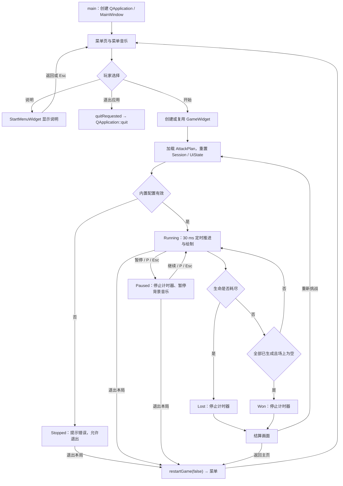
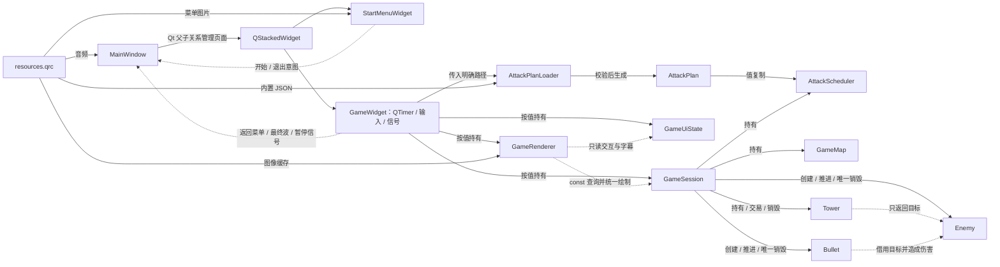
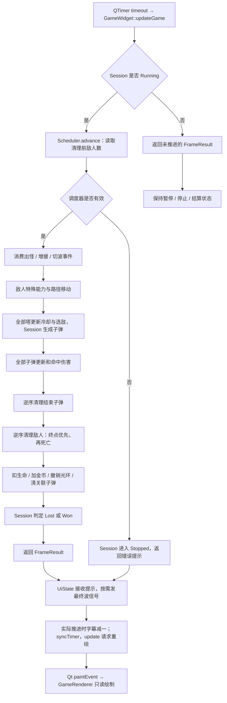

# “顶流争夺保卫战”项目报告补充

本文依据 2026 年 10 月 16 日工作区的 `core/`、`ui/` 分层实现，补充第四章“项目总体设计”和第五章“主要模块设计与实现”。章节与小节顺序保留原报告要求；代码标为源码节选或伪代码，速度和时间参数以当前实现为准。本文说明源码行为及设计目的；本轮重构的完整编译、回归和人工验收结果以 `HANDOFF.md` 的最新证据为准，不以结构调整完成代替验收通过。

## 四、项目总体设计

### 1. 整体流程

程序以 Qt 事件循环为基础，通过菜单、说明页、战斗和结算组织操作。`main()` 创建 `QApplication` 与 `MainWindow`，显示固定 1200×800 的主窗口，再调用 `exec()` 分发绘制、输入和定时器事件。主窗口启动菜单背景音乐，以 `QStackedWidget` 管理菜单页和游戏页。

菜单和说明共用 `StartMenuWidget`。玩家在菜单可以开始游戏、查看说明或退出应用，说明页通过返回按钮或 Esc 回到菜单。菜单只发出 `startGameClicked()` 或 `quitRequested()`，不直接创建游戏实例或终止应用；`MainWindow` 将退出请求连接到 `QApplication::quit()`，统一安排页面和应用级动作。

首次开始时，`MainWindow::ensureGameWidget()` 创建游戏页并连接返回菜单、最终波和暂停信号；游戏页构造时初始化定时器并调用 `restartGame(true)`。后续再次开始复用已有游戏页，重新加载进攻配置并重置战局。新局初始金币为 150、基地生命为 10、逻辑 tick 为 0，第一波将在默认第 23 tick 生成第一只敌人。

战斗由 `GameSession` 保存权威状态和实体，`GameWidget` 负责 Qt 事件与定时器适配。每次推进先产生到期出怪事件，再移动敌人、更新塔攻击和子弹、处理敌人离场及胜负。击败敌人增加金币，漏怪扣除基地生命；金币、生命、波次和累计生成数量由展示层读取并绘制。

玩家可以建塔、选塔、升级、出售，也可以在右上角查看近期进攻事件、暂停或退出本局。暂停将战局状态改为 `Paused` 并停止计时器，背景音乐同步暂停；恢复后继续原战局。退出本局会放弃当前进度，重置但不启动游戏，随后返回菜单。

生命小于等于 0 判定失败；生命仍大于 0、全部敌人已生成且场上敌人为空判定胜利。胜利允许部分敌人已经到达终点，只要基地生命没有耗尽。结算后停止计时器，可选择立即重试或重置后返回菜单。

**图 4-1 游戏整体流程**



图中，页面切换属于应用层，进攻配置属于加载层，战局推进属于核心层。重试与菜单返回共用重置入口，但前者传入 `true`，后者传入 `false`。外部节奏文件无效时回退默认节奏并提示，不阻止正常开局；内置配置无效才进入停止状态。

**实现依据：** `26C-/main.cpp` 的 `main()`；`26C-/ui/mainwindow.cpp` 的 `ensureGameWidget()`、`startGame()`、`showMenu()`；`26C-/ui/gamewidget.cpp` 的构造函数、`restartGame()`、`setPaused()`；`26C-/core/gamesession.cpp` 的 `checkResult()`。

### 2. 类与模块划分

项目保留 C++17 与 Qt 6 技术栈，将业务核心、Qt 界面和应用组织分开。`core/` 中的普通 C++ 类仅依赖 QtCore，不包含 `QWidget`、`QPainter`、`QPixmap` 或音频播放器；`ui/` 负责输入、绘制、图片缓存和音乐。原先集中在游戏控件中的职责不再由一个类共同持有。

| 模块 | 主要职责 | 重要边界与协作关系 |
| --- | --- | --- |
| `MainWindow` | 页面创建与复用、音乐、应用退出连接 | 用具名成员函数组织流程；持有页面和音频对象 |
| `StartMenuWidget` | 菜单/说明绘制与输入 | 持有本页图片、按钮范围和交互状态；发出开始、退出意图 |
| `GameWidget` | Qt 输入、计时器与信号适配 | 持有 Session、Renderer、UiState；不实现伤害和经济计算 |
| `GameSession` | 一局游戏的实体、经济、运行状态、攻击、清理和结算 | 唯一持有敌人、塔、子弹与选中塔引用；不读文件、不绘制 |
| `GameMap` | 固定地图、路径与放置几何 | 提供网格吸附、圆形边界、道路距离判定 |
| `AttackPlanLoader` | 配置读取、校验与整份回退 | 接收调用方指定的内置、外部路径，返回计划、警告或错误 |
| `AttackPlan` | 已验证的整局进攻配置值 | 只有加载器能构造；外部只读查询或复制整份值 |
| `AttackScheduler` | tick、稳定最小堆、生成及切波事件 | 从 Plan 复制配置，`advance()` 不读文件、不创建敌人 |
| `Enemy` | 移动、生命、护甲、技能、奖励和强化 | 提供只读状态；不持有图像或画家 |
| `Tower` | 基础属性、升级、冷却与目标选择 | 返回借用的敌人目标；由 Session 创建子弹 |
| `Bullet` | 追踪、命中、伤害和结束状态 | 非拥有引用目标敌人，不负责删除目标 |
| `GameRenderer` | 地图、全部实体、HUD 与覆盖层绘制 | 缓存图片；通过 const 查询读取模型，提供共享命中布局 |
| `GameUiState` / `UiDrawing` | 界面状态与共享按钮反馈 | UiState 保存悬停、按压、候选塔型、预览与字幕；不复制金币/生命/战局状态 |
| `resources.qrc` / CMake | 嵌入资源与目标组织 | `game_core` 只链接 QtCore，产品与测试共享源清单 |

`GameSession::State` 为 `Stopped`、`Running`、`Paused`、`Won`、`Lost`，是战局运行与结算状态的唯一依据。金币、生命、实体数量和选中塔也只由 Session 保存。UiState 的“候选塔型”表示下一次建造类型，与 Session 中“当前选中的已有塔”是不同概念。

**图 4-2 模块、依赖与对象关系**



图中，实线表示对象管理、配置传递或资源输入，虚线表示通知和非拥有读取。防御塔不再向外部容器追加子弹，所有实体创建与销毁集中到 Session。Renderer 不持有实体裸指针作为缓存，绘制时查询 Session 当前对象，避免重置后引用旧实体。

`QVector` 用于路径点、各波单位序列、到期事件和实体指针容器；其中敌人容器顺序决定塔遇到的第一个合法目标。调度待执行事件采用 `std::priority_queue`，按到期 tick 和插入序号排序。容器顺序与堆顺序承担不同用途。

Session 中三个指针容器都表示独占所有权；子弹目标和选中塔是借用引用。销毁敌人前先删关联子弹；清空整局时先删全部子弹，再删敌人和塔，并清除选中引用。Session 禁止复制，避免复制拥有型裸指针导致重复释放。相对地，QTimer、页面和音频对象遵循 Qt 父子对象管理。

信号槽用于应用边界通知，核心类无需继承 QObject。Session 通过 `FrameResult` 返回本帧提示和最终波事件，通过 `ActionResult` 返回操作结果；GameWidget 将其转换为界面刷新及已有 Qt 信号。这样的边界使战斗测试能够使用 `QCoreApplication` 直接调用产品逻辑。

**实现依据：** `26C-/core/gamesession.h` 的状态、结果结构及容器声明；`core/attackplan.h`、`attackplanloader.h`、`attackscheduler.h`；`26C-/ui/gamewidget.h`、`gameuistate.h`、`gamerenderer.h`；`26C-/cmake/GameTargets.cmake`。

### 3. 游戏循环设计

Qt 主事件循环接收窗口、键鼠和定时器事件。GameWidget 中的 QTimer 每 30 ms 请求一次逻辑更新，调用 `GameSession::step()`；核心逻辑本身不创建定时器，因此测试可以直接逐 tick 调用。只有 Session 为 Running 时推进，其他状态直接返回未推进的帧结果。

计时器控制的**源码节选**：

```cpp
void GameWidget::syncTimer()
{
    if (m_session.state() == GameSession::State::Running) {
        if (!m_timer->isActive()) m_timer->start(30);
    } else m_timer->stop();
}
```

本文中的 tick 或逻辑帧表示一次规则推进。目标间隔为 30 ms，理想频率约 33.3 次/秒；速度单位为 px/tick，攻击间隔和技能时间为 tick。实现没有按实际经过时间计算 delta time，系统负载和 Qt 定时器调度可能改变墙钟时间，不能把该间隔解释为保证固定画面帧率。

| 顺序 | 执行者与阶段 | 具体内容 |
| --- | --- | --- |
| 1 | Session 状态检查 | 非 Running 不推进 tick、实体或交易 |
| 2 | Scheduler 到期事件 | 以移动、清理前的敌人数观察清场，处理出怪、增援与切波 |
| 3 | Session / Enemy | 交替分路、施加强化；敌人先处理技能再移动 |
| 4 | Tower / Session | 所有塔更新冷却并返回目标，Session 创建子弹 |
| 5 | Bullet | 全部子弹推进与命中，本 tick 新弹也立即参与 |
| 6 | Session 清理子弹 | 逆序删除命中或失效对象 |
| 7 | Session 清理敌人 | 逆序处理；先漏怪后死亡，结算生命、奖励、Boss 光环和目标引用 |
| 8 | Session 胜负判定 | 生命耗尽优先，否则检查生成结束且场上为空 |
| 9 | GameWidget / UiState | 接收帧通知，按需发最终波信号；实际推进时字幕减一，再同步计时器并请求重绘 |
| 10 | Qt / Renderer | paintEvent 读取模型绘制，不推进规则 |

**图 4-3 单帧更新流程**



调度器观察移动前的场上数量，是保持原有波次衔接时序的关键；若先删除敌人再调度，可能提前进入下一波。所有塔先发射、再统一更新子弹，保持目标选择和伤害顺序。删除阶段倒序遍历，避免容器索引移动跳过对象。敌人同时死亡且已到终点时仍优先漏怪，不领取击杀奖励。

Session 在帧末完成胜负判断，再由适配层处理字幕和重绘。字幕在真实推进时统一减一，因此本 tick 新产生的 150 帧提示绘制前计数为 149，暂停不会消耗字幕。`update()` 是重绘请求，Qt 可以合并请求；绘制函数不参与扣血、生成或经济计算。

**实现依据：** `26C-/ui/gamewidget.cpp` 的 `updateGame()`、`syncTimer()`、`paintEvent()`；`26C-/core/gamesession.cpp` 的 `step()`、`checkResult()`；`26C-/ui/gameuistate.h` 的 `advanceSubtitle()`；`26C-/ui/gamerenderer.cpp` 的 `paint()`。

## 五、主要模块设计与实现

### 1. 开始界面与说明界面

StartMenuWidget 固定为 1200×800，分别加载菜单和说明图片，并在 paintEvent 中铺满控件区域。`m_showHelp` 为 false 时绘制菜单，为 true 时绘制说明。图片上的按钮是视觉内容，实际点击由 QRect 命中；图片加载失败时显示底色与错误文字，仍沿用相同交互范围。

| 点击区域 | QRect(x, y, width, height)，单位 px | 包含横坐标 | 包含纵坐标 |
| --- | --- | --- | --- |
| 开始游戏 | `QRect(218,345,303,83)` | 218～520 | 345～427 |
| 游戏说明 | `QRect(239,446,261,63)` | 239～499 | 446～508 |
| 退出游戏 | `QRect(239,526,261,63)` | 239～499 | 526～588 |
| 说明页返回 | `QRect(230,695,280,75)` | 230～509 | 695～769 |

整数 QRect 的右、下端点为起点加尺寸减一。说明页返回按钮实际在页面下方；程序使用上述矩形，不依赖图片文字识别。点击、悬停均调用同一 `buttonAt()`，因此菜单与说明页只命中各自当前有效的按钮。

交互采用按下记录、松开触发。按下左键时记录目标并显示按压；移动到其他区域会取消原按压；只有松开位置仍与有效按下目标一致，才执行动作。以下为 `mouseReleaseEvent()` 的**源码节选**：

```cpp
const Button released = buttonAt(event->position().toPoint());
const Button pressed = m_pressedButton;
m_pressedButton = Button::None;
m_hoveredButton = released;
update();
if (pressed == Button::None || pressed != released) return;
if (released == Button::Start) {
    clearInteraction();
    emit startGameClicked();
}
```

“说明”和“返回”改变 m_showHelp 并清交互状态；退出发出 quitRequested，由 MainWindow 连接到应用退出。菜单不会自行销毁游戏页。Esc 仅在说明页返回菜单，不触发战斗暂停。

鼠标跟踪使未按键移动也能更新悬停；有效区域显示手形光标，其余区域显示箭头。离开窗口或失去焦点清除按压与悬停，避免恢复焦点后意外触发。共享 `UiDrawing::drawButtonFeedback()` 绘制高亮和按压反馈，菜单传入圆角半径 20，战斗控件默认 13；共享的是视觉函数，两页仍分别维护自身的按钮枚举与输入动作。

**实现依据：** `26C-/ui/startmenuwidget.cpp` 的构造函数、`paintEvent()`、`buttonAt()`、`mousePressEvent()`、`mouseReleaseEvent()`、`mouseMoveEvent()`、`focusOutEvent()`、`keyPressEvent()`；`ui/buttonfeedback.cpp`；`ui/mainwindow.cpp` 的构造函数。

### 2. 地图与路径设计

地图绘制采用 game_map.jpg，逻辑坐标由 GameMap 固定为宽 1200、高 800，顶部 60 px 为 HUD 保留区域，格子边长为 60 px。背景图片不参与寻路；敌人路线与道路建塔限制共同读取 GameMap 中的折线。

| 路线 | 按顺序排列的路径点，单位 px |
| --- | --- |
| 上方 | (40,230) → (305,230) → (305,90) → (635,90) → (635,315) → (1050,315) |
| 下方 | (40,570) → (335,570) → (335,690) → (760,690) → (525,395) → (745,485) → (1050,485) → (1050,315) |

Session 对路线数量取模选择路径，并递增 `m_nextPathIndex`，因此按全局生成顺序交替分配上、下路线。分配计数不在切波时清零，只在重开整局时恢复。Enemy 保存路径点序列，从首点出发，以索引 1 指向首个移动目标。

移动算法的**数学说明**：

```text
dx = target.x - position.x
dy = target.y - position.y
distance = sqrt(dx² + dy²)

distance <= speed：直接到达目标点，转向下一个目标
distance > speed ：position += speed × (dx,dy) / distance
```

归一化方向使水平、垂直和斜向每 tick 使用同一速度。到达最后一点标记终点；一个 tick 只处理当前路段，不把未用完的移动距离继续分配到下一段。重复路径点按距离小于等于速度分支处理，避免除以零。

GameMap::snapToGrid() 先检查有限坐标，限制坐标后转整数并除以 60，再将横向格索引限制在地图内、纵向索引限制在 1～12。中心为 `(gridX×60+30, gridY×60+30)`。例如原始点击 (90,799) 吸附到 (90,750)，不会产生窗口外的 y=810；有效中心横坐标为 30～1170，纵坐标为 90～750。

建造分为两个边界：Renderer 的 `blocksMapInput()` 排除 HUD、控制按钮和已展开的事件面板；Session 的 `evaluateBuild()` 判断运行状态、地图范围、网格位置、塔圆形边界、道路距离、已有塔距离和金币。预览与实际点击复用这套组合，避免显示可建但实际失败。

| 规则 | 当前条件 |
| --- | --- |
| 原始点击 | 有限值，0≤x<1200，60≤y<800，且未被界面遮挡 |
| 塔边界 | 使用对应塔型初始半径，整个圆形在地图内且不伸入顶部 60 px |
| 道路 | 中心到任何路径线段距离至少 45 px |
| 已有塔 | 中心距至少 42 px |
| 经济与状态 | Session 为 Running，金币足够 |

道路距离采用投影到线段的方法，以下为**算法说明**：

```text
v = b - a，w = p - a
t = clamp((w·v)/(v·v), 0, 1)
nearest = a + t×v
distance = |p-nearest|
```

当 a=b 时直接求点到该端点的距离。投影比例限制在 [0,1]，保证检测的是线段而非无限直线。塔间距与道路距离都使用吸附后的中心；已有塔点击范围则由其当前升级后直径计算，二者用途不同。

**实现依据：** `26C-/core/gamemap.cpp` 的构造函数、`snapToGrid()`、`distanceToSegment()`、`circleInsideMap()`、`isNearRoad()`；`core/gamesession.cpp` 的 `spawnEnemy()`、`evaluateBuild()`；`core/enemy.cpp` 的 `update()`；`ui/gamerenderer.cpp` 的 `blocksMapInput()`、`evaluateBuild()`。

### 3. 敌人系统

Enemy 保存单个敌人的类型、路径进度、生命、护甲、速度、奖励和技能标志；Session 负责生成、集体强化与离场结算。Renderer 根据只读状态绘制贴图和血条，敌人模型本身不加载或缓存图片。

#### （1）基础属性与伤害

| 类型 | 基础最大生命 | 基础护甲 | 基础速度（px/tick） | 击败奖励 | 漏怪扣生命 | 能力 |
| --- | --- | --- | --- | --- | --- | --- |
| Bug | 40 | 0 | 2.4 | 10 | 1 | 普通敌人 |
| DDL | 28 | 0 | 3.6 | 15 | 1 | 一次冲刺 |
| Virus | 130 | 8 | 2.0 | 25 | 2 | 一次变异 |
| Boss | 550 | 18 | 1.35 | 100 | 5 | 首次出现触发光环 |
| Mutant | 160 | 12 | 1.2 | 60 | 2 | Virus 变异后基础属性 |

Mutant 不在波次中直接生成。未知类型保留源码备用行为：30 最大生命、0 基础护甲、2.2 px/tick、10 奖励；这与正常 Bug 的数值不同，不应在报告中合并。伤害按 `max(1, damage-armor)` 计算，生命最低裁剪到 0。即使攻击伤害不高于护甲，也至少造成 1 点伤害。

#### （2）六波与小队调度

内置 attack_waves.json 定义六波 90 个单位。Loader 将分组展开为有序 AttackUnit 列表，Plan 保存已验证配置；Scheduler 为当前波安排生成事件，不提前将所有六波一次性压入堆。

| 波次 | 按生成顺序组成 | 数量 | 开场等待（tick） | 首队 / 后续小队数量 | 小队首只最小间隔参数（tick） |
| --- | --- | --- | --- | --- | --- |
| 1 | Bug×8 | 8 | 23 | 1 / 1 | 14 |
| 2 | Bug×8，DDL×6 | 14 | 21 | 1 / 1 | 12 |
| 3 | Bug×8，DDL×10 | 18 | 19 | 2 / 2 | 10 |
| 4 | Bug×6，Virus×4 | 10 | 17 | 2 / 2 | 8 |
| 5 | DDL×10，Virus×4 | 14 | 17 | 3 / 3 | 8 |
| 6 | DDL×4，Virus×3，Boss×1，Virus×2，DDL×16 | 26 | 9 | 1 / 3 | 8 |
| 合计 | Bug×30，DDL×46，Virus×13，Boss×1 | **90** | — | — | — |

所有波的队内间隔为 9 tick，清场门槛为剩余敌人不超过 6，切波等待参数为 20 tick。开场等待相对本波开始 tick 计算。最后一波 Boss 为本波第 8 只、整局第 72 只，后续 Virus×2 和 DDL×16 标记为 Reinforcement；增援属于 90 只之内。

事件包含到期 tick、稳定插入序号、种类、波次与敌人类型。堆顶为最早到期，同 tick 按插入序号执行；每次插入/弹出为 O(log n)，读取堆顶为 O(1)。预览复制事件堆后取最多三个，不消费真实队列，但复制本身有 O(n) 开销。

小队内第 i 只的到期时间为 `firstTick + i×burstGapFrames`。安排下一队时，首只时间增加：

```text
max(spawnIntervalFrames, 当前计划小队大小×burstGapFrames + 1)
```

因此表中的 spawnIntervalFrames 是小队首只最小间隔参数，并不直接等于所有相邻敌人的间隔。第五波三只一队时实际首只间距为 max(8,3×9+1)=28 tick，不能写成每 8 tick 连续生成一只。第六波开场大小单独设为 1，明确保存原有开场节奏。

当前波所有单位生成后，Scheduler 进入等待清场状态。以移动和删除前的敌人数判断门槛，首次满足条件的 tick 为 C 时，安排在 `C + nextWaveDelayFrames - 1` 切波；默认即 C+19。等待条件允许场上仍有最多六个敌人，因此新旧波次可以重叠。

Scheduler 只维护已验证计划、事件堆和计数。文件读取与校验由 Loader 完成，外部节奏文件见第五章第 7 节。预览面板从 `preview(3)` 显示近期事件及 `剩余tick×0.03` 秒；等待清场且没有事件时，显示剩余数量门槛。

#### （3）DDL 冲刺与 Virus 变异

每次 Enemy::update() 先跳过死亡、到终点对象，再处理技能。DDL 的目标点索引达到 `path.size()/2` 后触发一次冲刺，速度为基础速度的 1.6 倍，即 5.76 px/tick；冲刺计数为 60 tick，约 1.8 秒，结束后恢复 3.6。这里判断的是路径点索引，不是累计移动距离的一半。

Virus 在同一索引条件下变异一次。类型改为 mutant，基础最大生命变为 160、基础护甲 12，当前生命增加 120 后裁剪到当前上限，速度变为 1.2、奖励变为 60。重新计算上限时保留已有晚期强化与 Boss 光环，因此变异不会覆盖此前强化。

`hasMutated()`、`lateGameEnhanced()` 和 `mutatedAfterLateEnhancement()` 向展示层暴露只读状态。最后一个标志记录变异发生时是否已经强化，用于保持备用颜色的原有变化顺序，不改变战斗数值。

#### （4）晚期强化和 Boss 光环

第 4 波开始，新生成敌人获得一次晚期强化：基础最大生命乘 1.3 后截断为整数、护甲加 3；当前生命也按 1.3 截断并裁剪。Boss 光环再把最大生命乘 1.5 并截断。基础数值与强化标志分别保存，避免对已经截断的值反复逆运算。

| 类型 | 基础最大生命 / 护甲 | 晚期最大生命 / 护甲 | 晚期并有光环的最大生命 / 护甲 |
| --- | --- | --- | --- |
| Bug | 40 / 0 | 52 / 3 | 78 / 3 |
| DDL | 28 / 0 | 36 / 3 | 54 / 3 |
| Virus | 130 / 8 | 169 / 11 | 253 / 11 |
| Boss | 550 / 18 | 715 / 21 | 1072 / 21 |
| Mutant | 160 / 12 | 208 / 15 | 312 / 15 |

Boss 首次生成时先加入敌人容器，再对所有存活且未到终点的敌人施加光环，因此 Boss 自身也会获得光环；光环期间新生成敌人同样受益。Boss 死亡或到终点均关闭全局光环，并撤销其余存活、未到终点敌人的加成，后续新怪不再获得光环。

光环施加和撤销使用当前生命比例映射，整数按四舍五入处理，以下为**源码节选**：

```cpp
m_hp = static_cast<int>(
    (static_cast<long long>(m_hp) * m_maxHp + oldMaxHp / 2) / oldMaxHp);
```

映射仅对旧上限大于 0 且当前生命大于 0 的对象执行，0 HP 不复活；撤销时存活对象最低保留 1 HP，并裁剪到新上限。重复施加、重复撤销由标志拦截。Session 的集体撤销还跳过已死亡、已到终点对象，避免改变离场结算分支。

**实现依据：** `26C-/core/enemy.cpp` 的 `setupByType()`、`takeDamage()`、`updateSpecialAbility()`、`mutateVirus()`、`calculateMaxHp()`、`applyBossAura()`、`removeBossAura()`；`core/gamesession.cpp` 的 `spawnEnemy()`、`step()` 及光环辅助函数；`core/attackscheduler.cpp` 的 `beginWave()`、`advance()`；`26C-/attack_waves.json`。

### 4. 防御塔系统

Tower 封装塔型、基础属性、等级、攻击冷却和升级规则；Session 执行金币校验和创建/删除，Renderer 负责名称、颜色、等级文字、实体与选中范围绘制。基础参数由私有不可变 BaseStats 表统一提供，构造、价格查询与放置半径读取同一份配置。

| 塔型 | 价格 | 基础伤害 | 范围（px） | 攻击间隔（tick） | 约合秒 | 初始直径（px） | 用途 |
| --- | --- | --- | --- | --- | --- | --- | --- |
| Normal 普通塔 | 50 | 18 | 120 | 25 | 0.75 | 36 | 初始成本低，通用输出 |
| Fast 速射塔 | 80 | 10 | 110 | 10 | 0.30 | 34 | 高频攻击，适合快速目标 |
| Heavy 重炮塔 | 120 | 45 | 165 | 55 | 1.65 | 44 | 单次伤害高，适合有护甲目标 |

每 tick 攻击计数加一，未达到间隔直接返回空目标；达到间隔时先清零，再按敌人容器顺序寻找第一个存活、未到终点且在射程内的目标。射程按中心欧氏距离小于等于 range 判定，不额外扣除图标或身体半径；无目标也会清零冷却。

Tower 不创建子弹，只返回借用目标。Session 中发射的**源码节选**如下：

```cpp
for (Tower* tower : m_towers) {
    if (Enemy* target = tower->updateAttack(m_enemies)) {
        m_bullets.append(new Bullet(tower->position(), target, tower->damage()));
    }
}
```

如此创建、持有与销毁均归 Session 管理。子弹记录发射时的伤害，后续塔升级不会追溯修改已经飞出的子弹。

鼠标按下时先处理控制按钮和面板遮挡，再尝试选择已有塔；点到塔时只选中，不建造。未点中已有塔则清除选择，并调用 Session::build()。合法时创建塔并扣费，失败时返回提示，不改变金币或数量。候选位置由 Renderer 绘制，绿色表示当前可建，红色表示道路、占用或金币不足等失败；地图外或界面遮挡区域不绘制候选塔。

已有塔点击半径为 `当前直径/2 + 8`，随升级增大；选中指针只存于 Session，Tower 不再保存另一份 selected 标志。Renderer 通过对象地址与 Session::selectedTower() 比较，决定是否显示攻击范围。

每塔最多 3 级。第 L 级升下一级费用为 `基础价格×L`，每次伤害加 10、范围加 12、直径加 2；攻击间隔大于 8 时减 3，不额外将结果限制到 8。

| 塔型 | 1→2→3 级伤害 | 1→2→3 级范围（px） | 1→2→3 级间隔（tick） | 两次升级费用 |
| --- | --- | --- | --- | --- |
| Normal | 18→28→38 | 120→132→144 | 25→22→19 | 50、100 |
| Fast | 10→20→30 | 110→122→134 | 10→7→7 | 80、160 |
| Heavy | 45→55→65 | 165→177→189 | 55→52→49 | 120、240 |

出售返还 `累计投入/2`，整数除法取整。累计投入包含建造和实际支付的升级费用；例如普通塔建造 50、升 2 级再付 50，总投入 100，出售返还 50。出售完成后 Session 清除选中引用，避免再次操作已删除对象。

| 输入 | 功能 | 有效条件 |
| --- | --- | --- |
| 1 / 2 / 3 | 选择下一次建造的 Normal / Fast / Heavy | Running |
| 鼠标左键地图按下 | 选择已有塔，或尝试建塔 | Running，未被界面遮挡 |
| U | 升级选中塔 | Running，有选择、未满级、金币足够 |
| X / Delete | 出售选中塔 | Running，有选择 |
| P / Esc | 暂停或继续 | Running / Paused，忽略自动重复键 |
| 右上角“预览” | 显示/隐藏近期进攻 | 未结算，运行或暂停 |
| 右上角“退出” | 放弃本局返回菜单 | 游戏页允许退出，包括配置失败的 Stopped |

失败操作通过 ActionResult 返回非模态字幕：建造位置不合法、建造金币不足、未选塔升级、已满级、升级金币不足和未选塔出售，均保留提前返回与经济校验。字幕显示不会阻塞游戏；暂停期间交易和塔型切换被拒绝。

**实现依据：** `26C-/core/tower.cpp` 的 `baseStatsForType()`、`updateAttack()`、`upgrade()`、`sellValue()`、`containsPoint()`；`core/gamesession.cpp` 的建造、选择、升级和出售函数；`26C-/ui/gamewidget.cpp` 的键鼠事件；`ui/gamerenderer.cpp` 的 `drawTower()`、`drawBuildPreview()`。

### 5. 子弹系统

Bullet 保存当前位置、目标 Enemy*、发射伤害、移动速度和完成状态。Session 在塔返回合法目标后创建子弹并加入自身容器；子弹不拥有目标敌人，也不拥有发射塔。由于伤害已经复制，原塔被出售不影响在途子弹继续追踪。

子弹每 tick 移动速度为 8 px。更新时先跳过已完成对象；目标为空、死亡或到终点则标记完成；否则根据敌人当前位置重新计算方向。距离不大于 8 px 时直接调用目标 takeDamage() 并结束，否则沿归一化方向移动 8 px。以下为**源码节选**：

```cpp
const QPointF targetPos = m_target->position();
const double dx = targetPos.x() - m_pos.x();
const double dy = targetPos.y() - m_pos.y();
const double distance = qSqrt(dx * dx + dy * dy);
if (distance <= m_speed) {
    m_target->takeDamage(m_damage);
    m_finished = true;
    return;
}
m_pos.setX(m_pos.x() + m_speed * dx / distance);
m_pos.setY(m_pos.y() + m_speed * dy / distance);
```

命中规则是中心距离与单步速度比较，没有复杂碰撞盒、穿透或范围伤害。距离为零直接命中，不发生方向除零。Renderer 将未完成子弹画为半径 8 px 的黄色圆形；视觉半径与运动命中阈值数值相同，但属于独立的展示参数。

子弹更新后，Session 倒序移除已完成对象。随后处理敌人离场前，还必须清理所有仍指向该敌人的子弹。原因是目标裸指针不会在 delete 后自动置空；仅判断 target 是否为空不能识别悬空引用，下次访问 isDead() 或 position() 会产生未定义行为。

一个实际顺序是：第一颗子弹本 tick 已更新但尚未命中，第二颗子弹随后击杀同一敌人；第一颗仍未标记结束，常规“完成子弹清理”不会删除它。因此敌人死亡分支必须再按 target() 清理，之后才能 delete 敌人。以下为离场清理的**源码节选**：

```cpp
removeBulletsTargeting(enemy);
delete enemy;
m_enemies.removeAt(index);
```

整局清空采用同一所有权原则，先释放全部子弹再释放敌人。展示层通过 position() 和 isFinished() 只读绘制，不保存跨帧目标缓存。

**实现依据：** `26C-/core/bullet.h/.cpp` 的构造函数、`update()`、`target()`、`position()`；`core/gamesession.cpp` 的 `step()`、`removeBulletsTargeting()`、`clear()`；`ui/gamerenderer.cpp` 的 `drawBullet()`。

### 6. 胜负判断与结果界面

Session 在每个正常推进 tick 的清理后检查胜负。生命耗尽的优先级高于胜利，因此同一 tick 全部敌人离场但基地生命归零时仍判失败。胜利要求生成过程已结束、实际累计生成数等于计划总数、场上敌人容器为空，并且前一失败条件未成立。

`checkResult()` 的**源码节选**：

```cpp
if (m_life <= 0) {
    m_state = State::Lost;
} else if (!m_scheduler.hasPendingGeneration()
           && m_scheduler.spawnedCount() == m_scheduler.totalEnemies()
           && m_enemies.isEmpty()) {
    m_state = State::Won;
}
```

状态进入 Won 或 Lost 后，后续 step() 不推进，GameWidget::syncTimer() 停止 QTimer。Renderer 先绘制当时场景，再覆盖整屏 win.png 或 lose.png；图片缺失则显示备用底色和胜负文字。绘制依据 isWon()/isFinished()，没有独立的胜负布尔副本。

| 结果状态 | 重新挑战 QRect | 返回主页 QRect |
| --- | --- | --- |
| Won | (280,465,300,95) | (600,465,300,95) |
| Lost | (280,565,300,95) | (600,565,300,95) |

结算按钮与运行控制共用 controlAt()/controlRect() 布局入口，松开时确认按压目标一致后触发。悬停、按压由 UiState 保存，视觉反馈使用共享绘制函数，拖出或失焦会取消。结算时不会再接受建塔或交易输入。

重新挑战执行 restartGame(true)：先停表，重置 UiState，读取内置及外部节奏计划，再由 Session 清空子弹、敌人和塔，恢复金币 150、生命 10、路线计数 0、Boss 标志、tick 0 和首波事件；配置成功后进入 Running 并启动 30 ms 定时器。配置失败则保持 Stopped 并显示错误。

返回主页由 GameWidget 发 backToMenuRequested，MainWindow::showMenu() 调用 restartGame(false)，重置完成仍为 Stopped，再切换菜单并恢复菜单焦点和音乐。再次开始时重新载入并启动。隐藏 QWidget 本身不会停止定时器，因此必须显式同步运行状态与定时器，不能以页面不可见替代停止。

暂停使用同一权威状态：Running→Paused 停表并发 pauseChanged(true)，Paused→Running 启表并发 false。暂停界面保留继续、退出和预览操作，阻止战斗和经济推进。失焦只清理输入状态，不自动暂停游戏。暂停后返回菜单会消除暂停状态，最终由页面切换选择菜单音乐。

**实现依据：** `26C-/core/gamesession.cpp` 的 `checkResult()`、`clear()`、`reset()`、`setPaused()`；`ui/gamewidget.cpp` 的 `restartGame()`、`syncTimer()`、`mouseReleaseEvent()`、`setPaused()`；`ui/gamerenderer.cpp` 的结果矩形与 `drawGameResultScreen()`；`ui/mainwindow.cpp` 的 `startGame()`、`showMenu()`。

### 7. 音乐与资源管理

资源保留在 26C- 下的 images/、music/、attack_waves.json 和 resources.qrc 中，目录分层没有改变已发布资源路径。qrc 中的 prefix 与 file 路径拼接形成访问路径；例如 prefix 已为 /images，而文件仍写 images/game_map.jpg，因此实际路径包含两次 images。

| 资源 | 当前访问路径 | 使用者 |
| --- | --- | --- |
| 菜单图片 | `:/images/images/menu_bg.jpg` | StartMenuWidget |
| 说明图片 | `:/images/images/help_bg.png` | StartMenuWidget |
| 地图与结果 | `:/images/images/game_map.jpg`、`win.png`、`lose.png`（后两者同图片前缀） | GameRenderer |
| 敌人贴图 | `:/images/images/enemy_bug.png` 等，DDL 为 `enemy.ddl.gif` | GameRenderer |
| 菜单背景音乐 | `qrc:/audio/music/menu.mp3` | MainWindow |
| 战斗背景音乐 | `qrc:/audio/music/battle.mp3` | MainWindow |
| 最终波音效 | `qrc:/audio/music/final_wave.wav` | MainWindow |
| 内置进攻计划 | `:/config/attack_waves.json` | AttackPlanLoader，经 QFile 读取 |

qrc 还保留 final_wave.mp3 和另一条 GIF 资源路径，但最终波实际没有切换到 final_wave.mp3。播放策略是重启 battle.mp3 循环，同时停止并重新播放一次 final_wave.wav。资源存在与实际使用是两个事实，不能因文件名推断正在播放。

MainWindow::initializeAudio() 创建一个 QMediaPlayer、一个 QAudioOutput 和一个 QSoundEffect，并把它们的父对象设为主窗口。背景音乐音量为 0.35，循环次数为 Infinite；最终波 WAV 音量为 0.8、循环次数为 1。`playLoopMusic()` 先 stop、再 setSource、设置循环并 play。菜单开始、战斗开始、最终波和返回菜单分别由具名函数组织，不依靠多层 lambda 捕获保存页面状态。

暂停信号只对背景播放器调用 pause()/play()；当前没有同步暂停单次 WAV 音效的实现。结算通过停游戏定时器阻止战斗，但没有在结算分支额外停止背景音乐。重构保持这些播放行为，不把“停止战斗”写成“停止所有声音”。

GameRenderer 构造时读取地图、结算图和五种敌人图标，并按类型缓存在 QHash 中。普通敌人图标绘制尺寸为 65×65，Boss 为 75×75，加载时保持比例和平滑缩放；绘制时按既有目标矩形输出。Enemy 的创建、变异和强化不再重复加载图像，只更新模型状态。

DDL 文件虽为 GIF，仍通过 QPixmap 加载并作为静态贴图绘制，没有 QMovie 帧推进。敌人缺图时，Renderer 用原有备用颜色和名称绘制圆形并显示血条；正常 Bug 的旧备用颜色/空标签行为也保留，不能在结构调整报告中声称顺带完成视觉修复。血条宽度按 `图标宽×hp/maxHp` 的整数比例计算。

外部节奏路径由 GameWidget 明确组装为可执行文件目录下的 attack_rhythm.json，再传给 Loader；核心模型和调度器不自行查询环境路径。示例文件 attack_rhythm.example.json 会复制到构建输出并随安装提供，需要复制或更名为 attack_rhythm.json 才启用，启动/重试读取，不进行热更新。

覆盖文件要求 version 为 1、waves 为六个对象；空对象保留对应默认波。允许覆盖的七项为 spawnIntervalFrames、burstSize、burstGapFrames、openingDelayFrames、openingBurstSize、nextWaveDelayFrames、clearThreshold。Frames 字段范围 1～10000 tick，小队大小范围 1～10，openingBurstSize 不超过 burstSize，clearThreshold 为 0～90 个敌人。外部文件不能改变敌人组成和数量。

加载器限制文件不超过 65536 字节，拒绝未知键、非整数、越界数值、错误结构以及非法内置敌人/Boss/增援布局。外部文件不存在或路径为空时静默使用默认值；存在但内容无效时整份回退默认节奏并返回警告，前面已解析的覆盖不会部分生效。内置文件无效则没有可用 Plan，GameWidget 清空战局并保持停止状态。

资源不编入 game_core 静态库：产品可执行文件嵌入完整 qrc，调度/战局测试按需嵌入仅含配置的测试资源，备用实体绘制测试可以不带图片资源。共享 GameTargets.cmake 定义同一份核心与 UI 源清单，避免产品和测试漏编不同实现。产品入口为 26C-/CMakeLists.txt，测试入口为 tests/CMakeLists.txt；后者定义调度、敌人、战局、实体绘制和整页 GUI 五类测试，定义存在不等于已经运行通过。

#### 验证状态与实际验收的区分

本章参数、公式、函数关系和片段以当前源码核对，设计目的与运行结果分别表述：

| 证据层次 | 本文能说明的内容 | 仍需实际证据 |
| --- | --- | --- |
| 静态源码核对 | 路径、状态归属、清理顺序、参数和调用关系 | 不单独证明完整构建、资源可用或交互验收 |
| 直接核心测试 | 测试连接真实核心方法，具备数值和生命周期回归入口 | 本轮执行命令、工具版本、退出结果见 HANDOFF 最新记录 |
| 绘制与 offscreen GUI | 具备实体备用绘制、键鼠和页面流程自动检查入口 | 以本轮实际运行记录判断，不沿用重构前的通过结论 |
| 人工桌面与声音 | 源码中有相应功能与资源声明 | 需要真实输入、画面检查与听音，不能由无界面测试替代 |

本轮已在 Qt 6.10.3 / MinGW 13.1.0 的新目录完成产品与测试编译，CTest 五组全部通过，菜单15个坐标检查通过；9张离屏截图与重构前基线PNG哈希一致，独立程序离屏启动存活3秒。具体命令、日志和首次失败修正见 HANDOFF.md 第22节。当前离屏环境缺字在基线也存在，真实桌面字体、键鼠和音频听感仍未人工验收，不能写作“重构全部人工验收通过”。菜单坐标脚本仅检查从真实源码读取的矩形及代表点，也不能单独证明整张图片的按钮边缘完全贴合。

**实现依据：** `26C-/resources.qrc`；`26C-/ui/mainwindow.cpp` 的音频相关具名函数；`ui/gamerenderer.cpp` 的构造函数、`drawEnemy()`、`drawBullet()`；`ui/gamewidget.cpp` 的 `restartGame()`；`core/attackplanloader.cpp` 的加载与校验；`26C-/cmake/GameTargets.cmake`、`26C-/CMakeLists.txt` 和 `tests/CMakeLists.txt`。
